# CostPilot

**An AI assistant that explains your cloud bill in plain English, with numbers you can trust.**

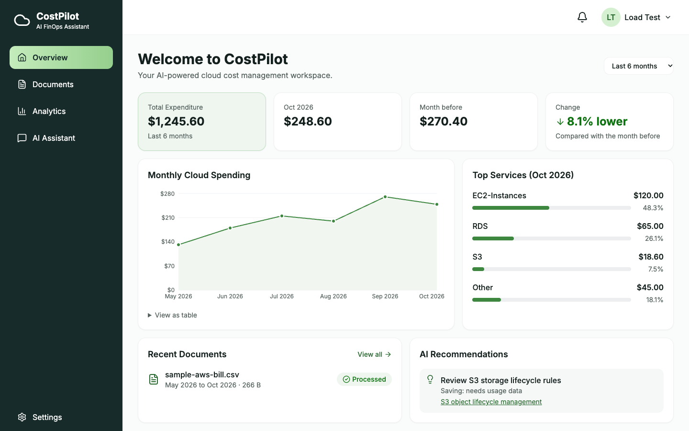

> **Status:** All 12 phases are built and tested on a laptop: five clouds, hybrid AI agents, a trust layer, monitoring, data export and deletion. Going live on AWS waits on one permission change in the AWS account. See the [roadmap](docs/plan/ROADMAP.md).
>
> Every screenshot here is the real running app, using a made-up bill.

## The problem

Cloud bills are hard to read. A single monthly report can have thousands of rows, and each cloud provider uses its own format. So people usually only notice a cost problem after they have paid for it. They then have to ask questions like:

- Why did my bill go up this month?
- Which service costs me the most?
- Where can I safely save money?

General AI chatbots are risky for this job. They can invent numbers, and they can suggest savings that have no evidence behind them. For money, a wrong answer that sounds right is worse than no answer.

## The solution

CostPilot gives you one place to upload bills, see your spending and ask questions.

- **Upload any bill.** Bills from any cloud are converted into one standard format, called [FOCUS](https://focus.finops.org/).
- **See your spending.** The dashboard shows totals, trends, top services and unusual changes, for all your history.
- **Ask in plain English.** The AI assistant reads your data through safe tools and uses trusted cloud documentation.
- **Trust the numbers.** All calculations are done by normal code. The AI cannot write a figure of its own. Every answer shows its evidence and a grade.
- **Keep data private.** Each user's data is locked to their own workspace, and only summary numbers ever reach the AI.

## Features

| Area | What it does |
|---|---|
| **Overview** | Total spending, monthly change, trends, top services and recommendations |
| **Documents** | Upload, track, reprocess and delete bills |
| **Analytics** | Compare periods, explore services and find unusual spending |
| **AI Assistant** | Ask questions about your bills and cloud cost best practice |
| **Settings** | Download all your data as JSON, or delete your account |
| **Monitoring** | Traces and metrics through OpenTelemetry, with a Grafana dashboard |

**Clouds:** AWS, Azure, Google Cloud, Oracle Cloud and DigitalOcean, plus any FOCUS file. See the [cloud bills guide](docs/guides/cloud-bills.md).

## Screenshots

| | |
|---|---|
| 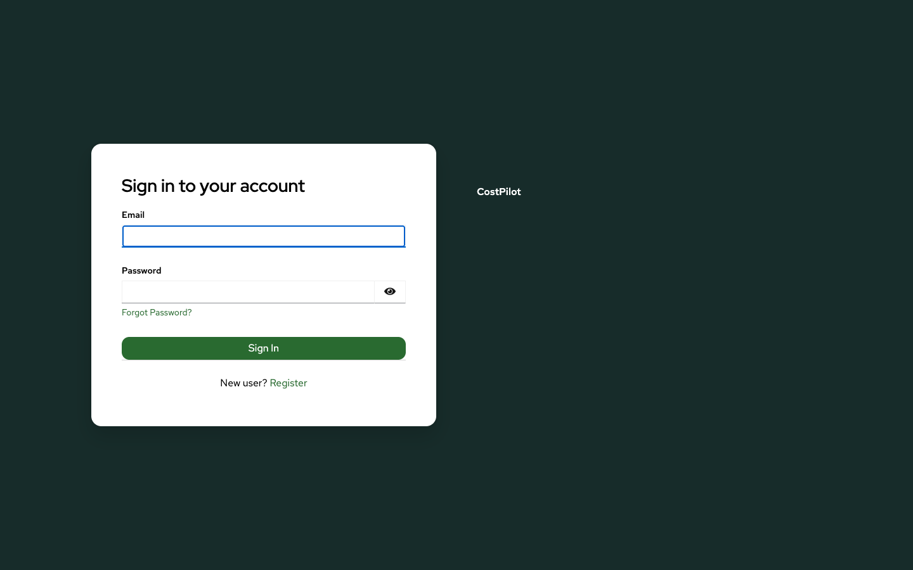 | 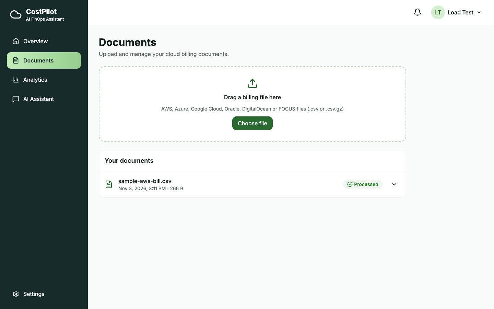 |
| **Sign in.** Keycloak's page, in CostPilot's colours | **Documents.** Upload, status, reprocess and delete |
| 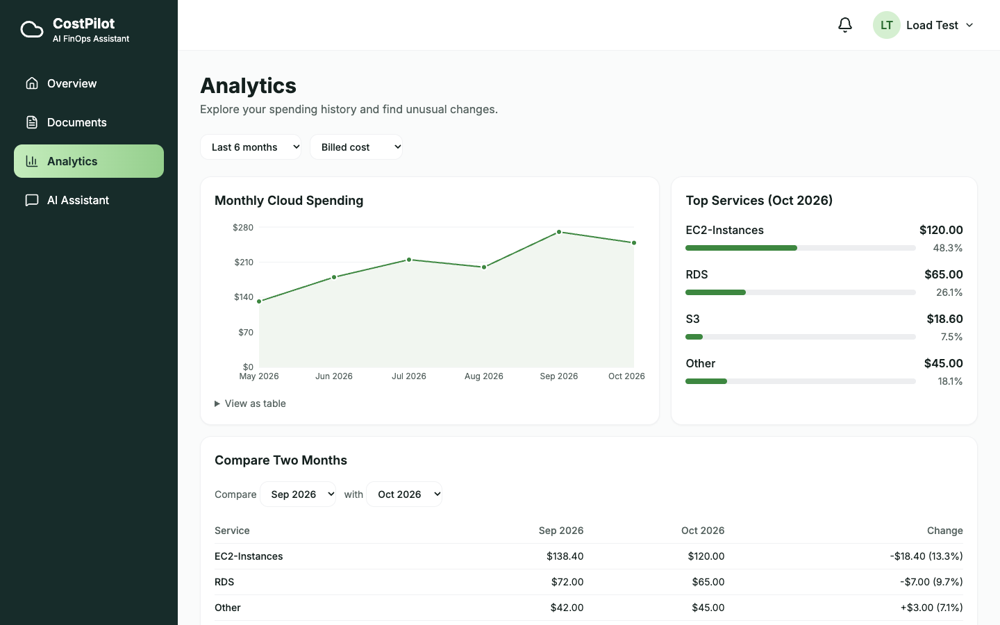 | 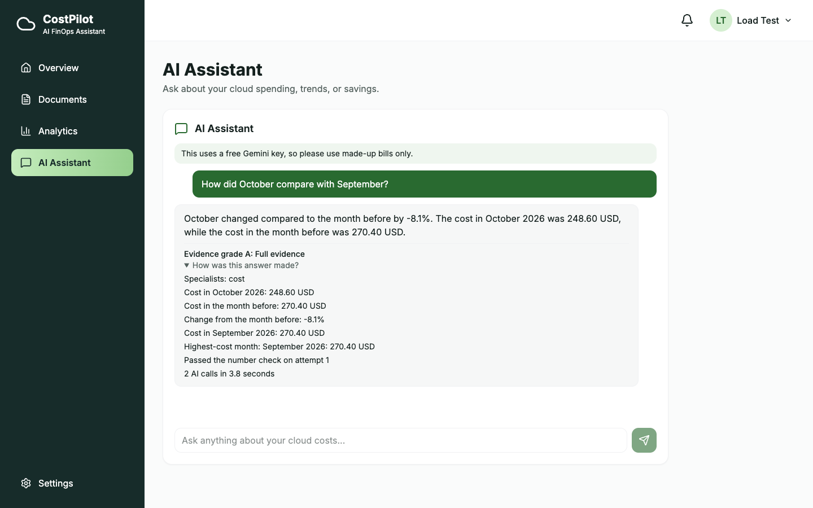 |
| **Analytics.** Trends, top services and month-by-month comparison | **AI assistant.** Every figure comes from code. The answer shows its grade, facts and AI calls |
| 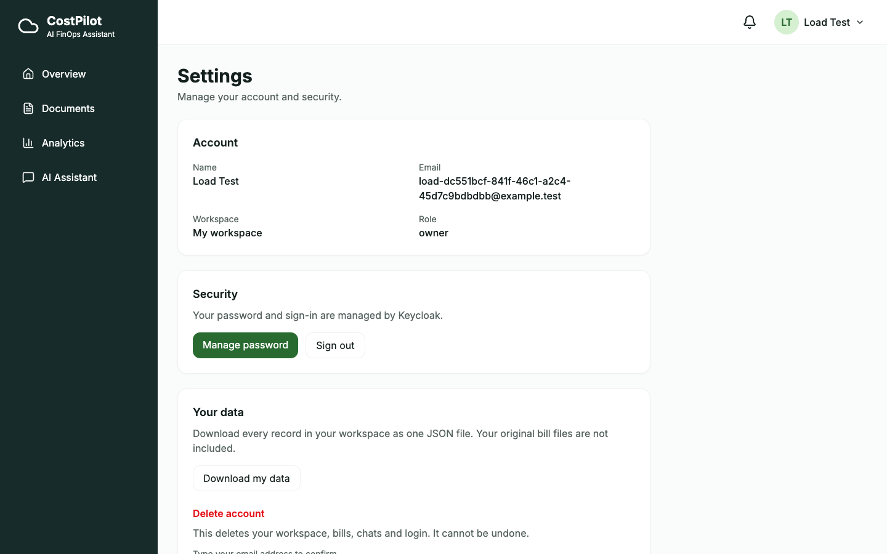 | 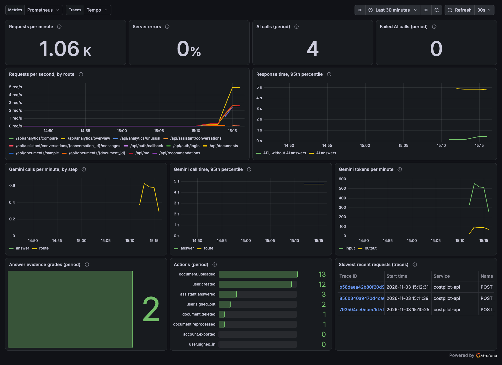 |
| **Settings.** Download your data, or delete your account | **Monitoring.** Requests, errors, Gemini use and answer grades |

A five-minute tour: [demo walkthrough](docs/guides/demo.md).

## Measured results

| What | Result | How to repeat it |
|---|---|---|
| Tests | 380 backend, 36 frontend, 13 browser journeys | `make check`, `make e2e` |
| Documentation search | 18 of 18 questions found the right page | `make eval-search` |
| Assistant, standard questions | 15 of 15 | `make eval-assistant` |
| Hard questions, with and without AI specialists | 10 of 10 against 6 of 10 | `make eval-agents` |
| Answers graded against reference answers | 9 of 12. The grader also found and helped fix a real bug | `make eval-quality` |
| Load test, 25 users at once on a laptop | 57 requests a second, 0 errors | `make load-test` |
| Backup and restore | Every table restored with the same row counts | `make backup-check` |

## System overview

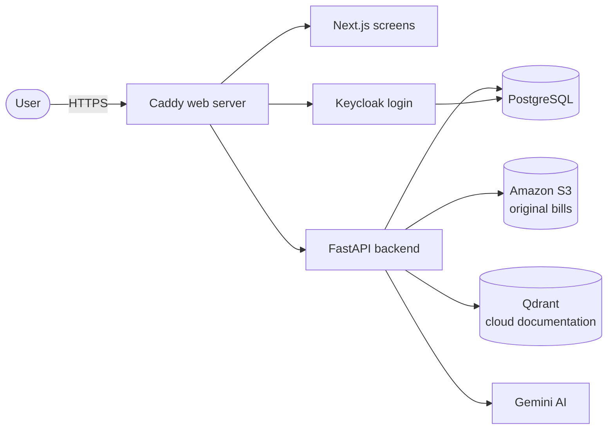

## Inside the backend

The backend is one app, split into clear modules. This keeps it simple to run, but a module can become its own service later if needed.

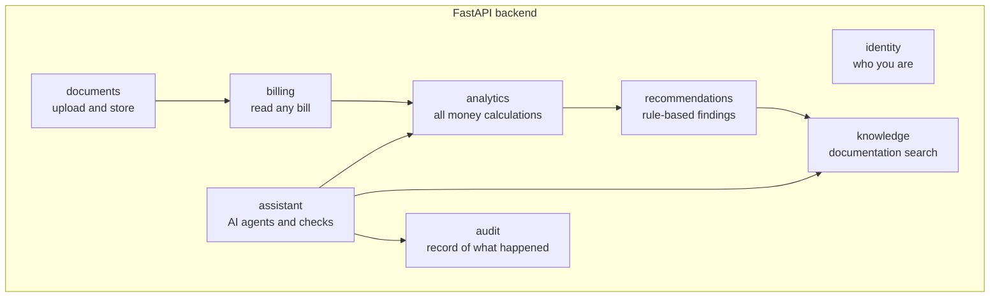

Each module follows clean architecture: `api → application → domain ← infrastructure`. Automatic checks fail the build if these rules are broken.

## How a bill is processed

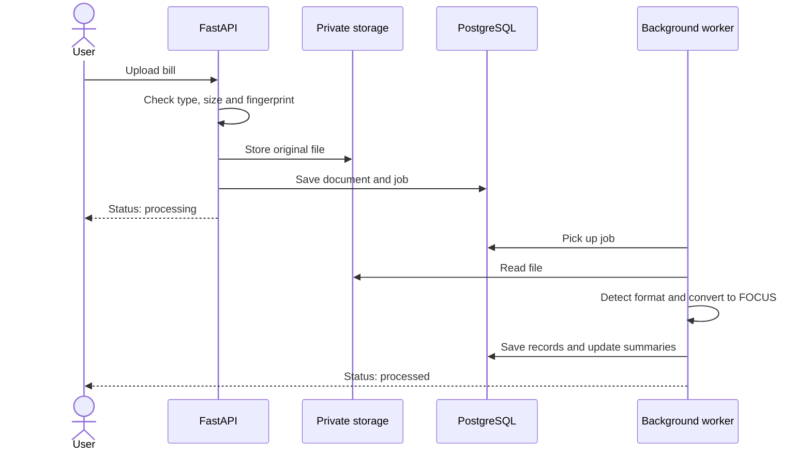

## How a question is answered

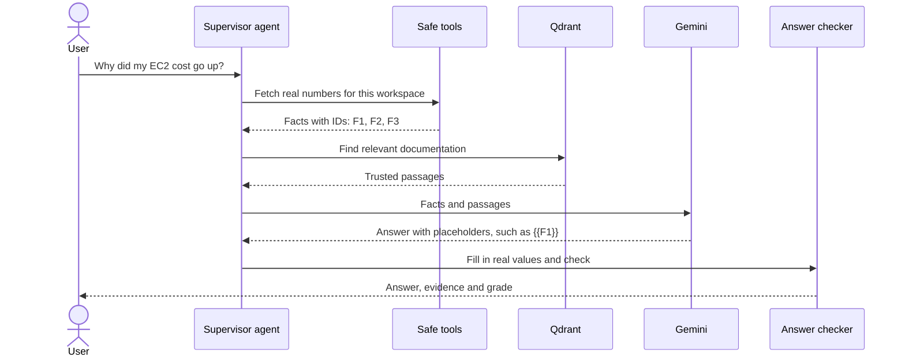

The AI writes `{{F1}}` instead of a number, and our code fills in the real value. So it cannot make up a figure. See [how the AI is kept honest](docs/architecture/ai.md).

## Deployment

Everything runs on one small server, with free services around it.

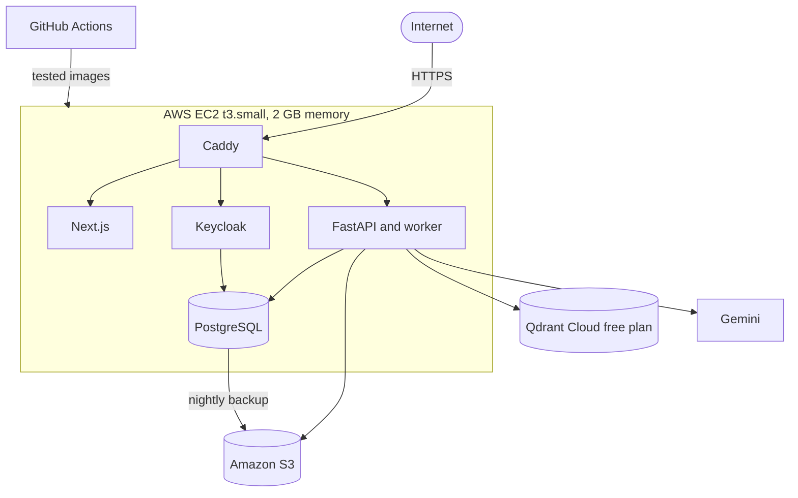

There is no SSH port. GitHub deploys through AWS Systems Manager, with no stored AWS keys. Terraform needs the GitHub owner and repository IDs to trust the deploy job. See the [deployment guide](docs/guides/deployment.md) and [decision 0011](docs/decisions/0011-deployment-design.md).

## Tech stack

| Part | Tools |
|---|---|
| Frontend | Next.js, React, TypeScript, Tailwind CSS, Recharts, TanStack Query |
| Backend | Python, FastAPI, Pydantic, SQLAlchemy, Alembic |
| Data | PostgreSQL, NumPy, Amazon S3 |
| AI | Gemini, LangChain, LangGraph, Qdrant |
| Login | Keycloak |
| Testing | Pytest, Vitest, Playwright, DeepEval or Ragas |
| Security | Gitleaks, Bandit, Trivy, Checkov, Row-Level Security |
| Delivery | Docker, GitHub Actions, GHCR, Terraform, Caddy |
| Monitoring | OpenTelemetry, Prometheus, Grafana |

## Getting started

You need Docker (we use [Colima](https://github.com/abiosoft/colima)), [uv](https://docs.astral.sh/uv/), Node (version in `.nvmrc`), pnpm, Gitleaks and pre-commit. See the [getting started guide](docs/guides/getting-started.md) for how to install them.

```bash
make setup   # Install everything and create your .env
make up      # Start all services
make check   # Run all tests and checks
make e2e     # Test the full journeys in Chrome
```

| Service | Address |
|---|---|
| Web app | http://localhost:3010 |
| API docs | http://localhost:8010/api/docs |
| Keycloak | http://localhost:8090 |
| Test email inbox | http://localhost:8025 |
| Grafana (after `make monitoring`) | http://localhost:3011 |

## Project structure

```
apps/
  api/        FastAPI backend, split into modules
  web/        Next.js frontend, split into features
docs/         Plans, architecture, decisions, guides and build log
infra/        Terraform, production setup, Keycloak, monitoring and load test
samples/      Generator for made-up bills
scripts/      Project checks and setup
```

## Documentation

- [Documentation index](docs/README.md)
- [Roadmap and progress](docs/plan/ROADMAP.md)
- [Build log](docs/logs/BUILD-LOG.md)
- [Technical verification](docs/architecture/technical-verification.md)
- [Security review and load test](docs/architecture/security-review.md)
- [Putting it online](docs/guides/deployment.md) and [monitoring](docs/guides/monitoring.md)
- [Demo walkthrough](docs/guides/demo.md)
- [Project rules](AGENTS.md)
