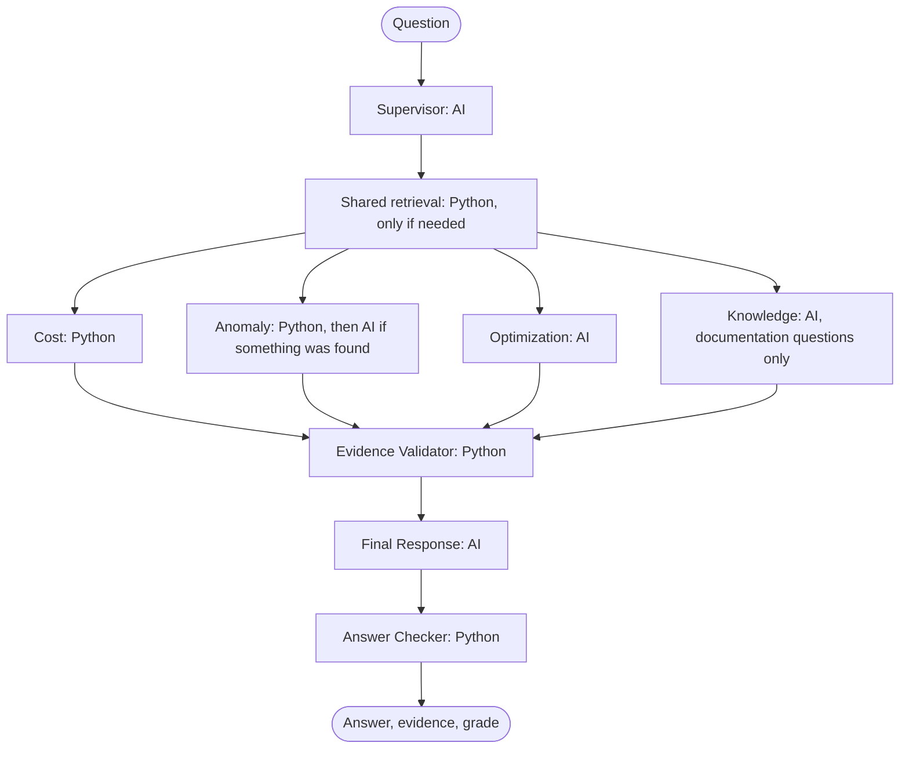

# AI system

## What each tool does

| Tool | Job |
|---|---|
| **LangGraph** | Runs the steps of each answer, in order |
| **LangChain** | Connects to Gemini, tools and document search |
| **Gemini** | Understands the question and writes the explanation |
| **Qdrant** | Finds relevant trusted documentation |

## How a question flows

The supervisor makes one AI call and can choose several specialists. LangGraph runs those specialists in parallel, and code joins their evidence and gives each fact a new id. Specialists are plain code, so a question uses **two AI calls at most**: one to choose routes, and one to write the answer.

> **Built so far:** steps 1, 2, 6 and 7 below are built, and the supervisor uses AI while specialists are plain code. Steps 3, 4 and 5 arrive in Phases 7 and 8. See [technical verification](technical-verification.md).

## How the AI is kept honest

1. **Tools run first.** Code fetches real numbers and gives each fact an ID, such as `F1`.
2. **The AI writes placeholders.** It writes "EC2 rose to `{{F1}}`", and our code fills in the value.
3. **A checker reads the answer.** Any money or percentage not linked to a fact is rejected. After one retry, a plain template answer is used.
4. **Evidence gets a grade.** Code gives the grade, based on the rules below. The AI's own confidence is not used.
5. **Savings need proof.** A savings figure only appears if code can calculate it. Otherwise it shows "Needs usage data".
6. **Workspace access is locked.** Tools get the workspace ID from the login session. It is not a tool input, so the AI cannot change it.
7. **Bills are untrusted.** A tag on a bill could contain "ignore your instructions". Only approved fields ever reach the AI.

## Evidence grades

| Grade | Meaning |
|---|---|
| **A** | Full billing detail and matching documentation |
| **B** | Billing detail, or documentation, with a small gap |
| **C** | Summary data only, so the answer is limited |
| **D** | Not enough evidence. The answer says so |

## Recommendations

Plain-code rules find problems, such as old storage types. The AI only explains them. They are created once, after a bill is processed, and saved. So opening the dashboard uses no AI calls.

## Privacy

Google's terms say not to send sensitive or confidential information to the free Gemini service, and that human reviewers may read it. So:

- Develop and demo with made-up bills only.
- A privacy filter sends only approved summary fields: never account IDs, resource names or tags.
- The app shows a notice when `GEMINI_TIER=free`.
- Use a paid key before uploading real bills. No code changes are needed.

## Planned hybrid agents

Phase 8 adds specialist AI agents where they add real reasoning. Money stays in Python. See [decision 0010](../decisions/0010-hybrid-agents-after-trust-layer.md).

| Question | AI calls now | AI calls in Phase 8 |
|---|---|---|
| "How much did I spend?" | 2 | 2 |
| "Why did EC2 rise?", nothing unusual | 2 | 2 |
| "Why did EC2 rise?", a real anomaly | 2 | 3 |
| "How can I save on S3?" | 2 | 3 |
| "Explain Savings Plans" | 2 | 3 |
| "Why did it rise, and how can I save?" | 2 | 4 |
| Off-topic | 1 | 1 |

Each question is limited to 4 AI calls. If a specialist fails or the limit is reached, the answer still goes out using Python facts.

## How documentation search works

| Step | File |
|---|---|
| List of trusted pages | `knowledge/sources.yaml` |
| Load and clean each page | `modules/knowledge/infrastructure/html_page_loader.py` |
| Split, embed and save | `modules/knowledge/application/indexer.py` |
| Search, filtered by cloud | `modules/knowledge/application/search_service.py` |

- Only sites in `KNOWLEDGE_ALLOWED_HOSTS` can be loaded, and redirects are checked too.
- `make reindex` skips pages that have not changed, so running it again uses no Gemini quota.
- Matches below `search_min_score` are dropped, so a weak match is never used as evidence.
- If search is down, the result says so, and the AI can still answer bill questions.

## Measuring quality

From Phase 5, a set of test questions measures search quality. Phase 7 adds a scored test set and a baseline for answers. In Phase 11, DeepEval or Ragas adds automatic scoring, backed by human-checked test cases.
