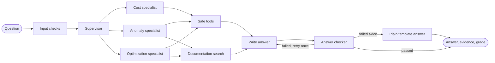

# AI system

## What each tool does

| Tool | Job |
|---|---|
| **LangGraph** | Runs the steps of each answer, in order |
| **LangChain** | Connects to Gemini, tools and document search |
| **Gemini** | Understands the question and writes the explanation |
| **Qdrant** | Finds relevant trusted documentation |

## How a question flows

The supervisor and specialists are real LangGraph agents, but most steps are plain code. The aim is **at most 3 AI calls per question**, because free Gemini keys allow very few requests per minute.

## How the AI is kept honest

1. **Tools run first.** Code fetches real numbers and gives each fact an ID, such as `F1`.
2. **The AI writes placeholders.** It writes "EC2 rose to `{{F1}}`", and our code fills in the value.
3. **A checker reads the answer.** Any money or percentage not linked to a fact is rejected. After one retry, a plain template answer is used.
4. **Evidence gets a grade.** Code gives the grade, based on the rules below. The AI's own confidence is not used.
5. **Savings need proof.** A savings figure only appears if code can calculate it. Otherwise it shows "Needs usage data".
6. **Workspace access is locked.** Tools get the workspace ID from the login session. It is not a tool input, so the AI cannot change it.
7. **Bills are untrusted.** A tag on a bill could contain "ignore your instructions". Only approved fields ever reach the AI.

## Evidence grades

| Grade | Meaning |
|---|---|
| **A** | Full billing detail and matching documentation |
| **B** | Billing detail, or documentation, with a small gap |
| **C** | Summary data only, so the answer is limited |
| **D** | Not enough evidence. The answer says so |

## Recommendations

Plain-code rules find problems, such as old storage types. The AI only explains them. They are created once, after a bill is processed, and saved. So opening the dashboard uses no AI calls.

## Privacy

Google's terms say not to send sensitive or confidential information to the free Gemini service, and that human reviewers may read it. So:

- Develop and demo with made-up bills only.
- A privacy filter sends only approved summary fields: never account IDs, resource names or tags.
- The app shows a notice when `GEMINI_TIER=free`.
- Use a paid key before uploading real bills. No code changes are needed.

## Measuring quality

From Phase 5, a set of test questions measures search quality. In Phase 10, DeepEval or Ragas adds automatic scoring, backed by human-checked test cases.
