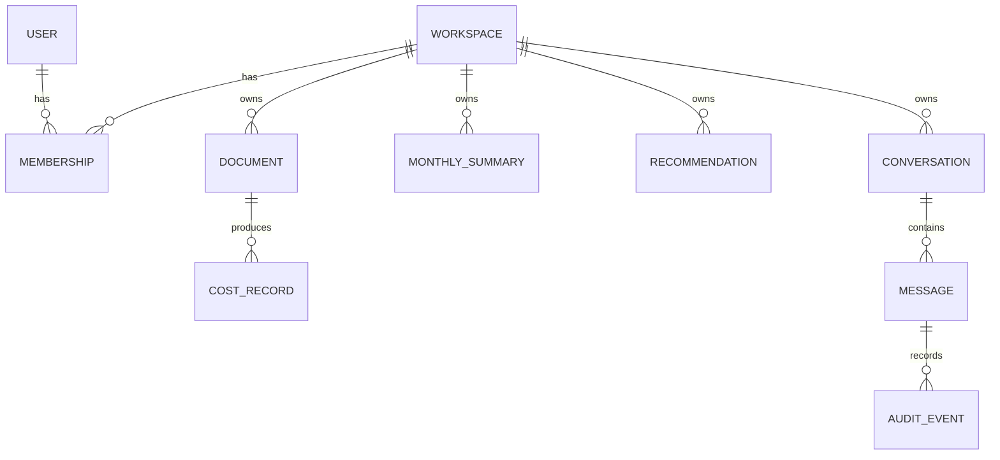

# Data model

This is the planned design. Tables are created in the phase shown, using Alembic migrations.

| Table | Purpose | Phase |
|---|---|---|
| `users` | Links a Keycloak user to our data | 1 |
| `sessions` | Login sessions. Stores a hash of the browser ticket and the encrypted ID token | 1 |
| `workspaces`, `memberships` | Who owns what | 1 |
| `audit_events` | Record of important actions | 1 |
| `documents` | Uploaded files, fingerprint, status, period | 2 |
| `jobs` | Background work queue | 2 |
| `cost_records` | One row per billed item, in FOCUS format | 3 |
| `monthly_summaries` | Fast totals for dashboards | 3 |
| `conversations`, `messages` | Chat history | 6 |
| `recommendations` | Saved findings with evidence | 7 |

## `cost_records`: the most important table

Column names follow FOCUS, in `snake_case`.

| Column | Meaning |
|---|---|
| `workspace_id`, `document_id` | Owner and source file |
| `provider_name` | `aws`, `azure`, `gcp`, `oci`, `digitalocean` |
| `billing_account_id`, `sub_account_id` | Which cloud account |
| `charge_period_start`, `charge_period_end` | When the cost happened |
| `service_name`, `service_category` | For example, `Amazon EC2` and `Compute` |
| `charge_category` | Usage, Purchase, Tax, Credit or Adjustment |
| `billed_cost`, `effective_cost`, `list_cost` | What was invoiced, the true cost after discounts, and the public price |
| `billing_currency` | For example, `USD` |
| `region_id`, `resource_id`, `sku_id` | Detail, when the file provides it |
| `consumed_quantity`, `consumed_unit` | How much was used |
| `tags` | Labels, stored as JSON. Never sent to the AI |
| `detail_level` | `service_month` or `line_item` |

## Rules

- Money uses `NUMERIC`, never floating point.
- Currencies are never added together.
- Every user-data table has `workspace_id` and a Row-Level Security rule. `users` and `sessions` have no workspace, because we must read them before we know who is asking. Workspace data is never in those tables.
- `detail_level` tells the AI what it can honestly answer from a file.
