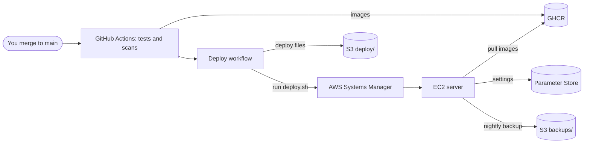

# Putting CostPilot online

This guide takes CostPilot from your laptop to a real web address with HTTPS. You do it once. After that, every merge to `main` deploys itself.

## How it fits together



**New words, in one line each**

| Word | Meaning |
|---|---|
| **Terraform** | Describes AWS resources in files, then creates them. Running it again changes only what is different |
| **EC2** | A server you rent from AWS |
| **Systems Manager (SSM)** | Lets AWS run commands on the server, or open a terminal on it, with no SSH port open |
| **Parameter Store** | A free AWS place for settings and passwords, stored encrypted |
| **OIDC** | GitHub proves who it is to AWS with a short-lived token, so no AWS keys are stored in GitHub |
| **GHCR** | GitHub's store for Docker images |
| **Caddy** | The front door. It gets a free HTTPS certificate and sends each path to the right service |
| **DuckDNS** | A free web address that points at your server |

**One address for everything**

| Path | Goes to |
|---|---|
| `/api/...` | FastAPI |
| `/auth/...` | Keycloak sign-in pages. The admin console is blocked |
| Everything else | Next.js |

## What you need first

- An AWS account, and the AWS CLI signed in as an admin user on your laptop: `aws sts get-caller-identity` should work.
- Terraform 1.15 or newer: `brew install terraform`.
- The Session Manager plugin, to reach the server: `brew install --cask session-manager-plugin`.

## Step 1: Check the server size is free

Keycloak needs about 1 GB of memory, so the 1 GB `t3.micro` is too small. Check that `t3.small` is covered on your account:

```bash
aws ec2 describe-instance-types --filters Name=free-tier-eligible,Values=true \
  --query "InstanceTypes[].InstanceType" --output text
```

If `t3.small` is not listed, stop and decide before going further. It would cost money.

## Step 2: Budget alert first, then the server

```bash
cd infra/terraform
cp terraform.tfvars.example terraform.tfvars   # then fill it in
terraform init
terraform apply -target=aws_budgets_budget.monthly   # the alert, on its own, first
terraform apply                                       # everything else
```

Read the plan Terraform shows before typing `yes`. It creates:

- A `t3.small` server with an encrypted disk, 2 GB of swap and automatic security updates
- A fixed public address (about $3.65 a month, paid from free credits)
- Network rules: only ports 80 and 443 are open. There is no SSH
- One private, encrypted S3 bucket for bills, backups and deploy files
- Narrow permissions for the server and for the GitHub deploy job
- A monthly budget alert, sent by email when real charges pass $1

`terraform output` shows the values you need below.

> **Keep `terraform.tfstate` safe.** It is how Terraform remembers what it made. It is ignored by Git, so copy it somewhere safe.

## Step 3: Web address

1. Sign in at https://www.duckdns.org and add a name, such as `costpilot`.
2. Set its IP to `terraform output public_ip`.

## Step 4: Qdrant Cloud

1. Create a free cluster at https://cloud.qdrant.io and copy its URL and API key.
2. Fill the search index from your laptop:
   ```bash
   QDRANT_URL=<cluster-url> QDRANT_API_KEY=<key> make reindex
   ```
3. In GitHub, add `QDRANT_URL` and `QDRANT_API_KEY` as repository secrets. The weekly job uses them to keep the free cluster awake.

## Step 5: An email service

Keycloak sends sign-up and password emails. Mailpit only catches them on your laptop. Any SMTP service works. Brevo and Amazon SES both have free allowances. Check their current limits before choosing. You need its host, port, user and password.

## Step 6: Production settings

```bash
python3 scripts/sync_env.py infra/production/settings.example infra/production/settings
```

This makes `infra/production/settings`, which Git ignores, with new passwords and keys already filled in. Fill in the blanks. Then copy every value into Parameter Store, encrypted:

```bash
infra/production/put-settings.sh infra/production/settings
```

For `registry/GHCR_TOKEN`, make a classic GitHub token with only `read:packages`. The server uses it to pull images while the repository is private. It is never given to the app.

## Step 7: Connect GitHub

1. In the repository settings, add an **environment** called `production`. You can require your own approval before each deploy.
2. Add these **variables** (not secrets, they are not sensitive):

| Variable | Value |
|---|---|
| `AWS_DEPLOY_ROLE_ARN` | `terraform output deploy_role_arn` |
| `AWS_INSTANCE_ID` | `terraform output instance_id` |
| `S3_BUCKET` | `terraform output bucket_name` |
| `AWS_REGION` | Your region, such as `ap-south-1` |
| `APP_URL` | `https://<name>.duckdns.org` |

Until `AWS_DEPLOY_ROLE_ARN` is set, the Deploy workflow skips itself.

## Step 8: Deploy

Merge to `main`. CI tests and scans everything, publishes the images to GHCR, and then the **Deploy** workflow:

1. Uploads `infra/production` to S3
2. Asks the server, through Systems Manager, to run `deploy.sh`
3. `deploy.sh` fetches the settings, pulls the images, starts them, waits until every service is healthy, installs the nightly backup and prints memory use
4. The workflow checks `https://<name>.duckdns.org/api/health`

To deploy `main` again by hand: **Actions → Deploy → Run workflow** on `main`.

## Everyday tasks

**Open a terminal on the server**

```bash
aws ssm start-session --target <instance-id>
sudo -i
cd /opt/costpilot/current
docker compose ps
docker compose logs --tail 100 api
```

**Keycloak admin console.** It is blocked on the public address. Open a tunnel, then visit http://localhost:8080/auth/admin:

```bash
aws ssm start-session --target <instance-id> \
  --document-name AWS-StartPortForwardingSession \
  --parameters portNumber=8080,localPortNumber=8080
```

**Backups.** They run every night at about 03:00 UTC and are kept for 14 days.

```bash
systemctl list-timers costpilot-backup.timer   # when the next one runs
systemctl start costpilot-backup.service       # back up now
./restore.sh check latest                      # prove the newest backup restores in full
./restore.sh replace latest                    # replace live data. Asks you first
```

`restore.sh check` restores into spare copies and compares every table's row count with the counts saved at backup time. The live data is not touched. A row written during the backup can make it report a small difference. Run it again if so.

**Memory.** `free -m` and `docker stats --no-stream`. Each deploy also prints them.

## What it costs

| Item | Cost |
|---|---|
| `t3.small`, 20 GB disk | Paid from AWS free credits |
| Public IPv4 address | About $3.65 a month, from free credits |
| S3, Parameter Store, Systems Manager, budget alert | Free at this size |
| Qdrant Cloud, DuckDNS, Let's Encrypt, GHCR | Free |

When the free credits end, the budget alert tells you before real charges grow.

## Taking it down

```bash
cd infra/terraform && terraform destroy
```

The bucket keeps old file versions, so empty it in the S3 console first, or `destroy` stops with an error.
