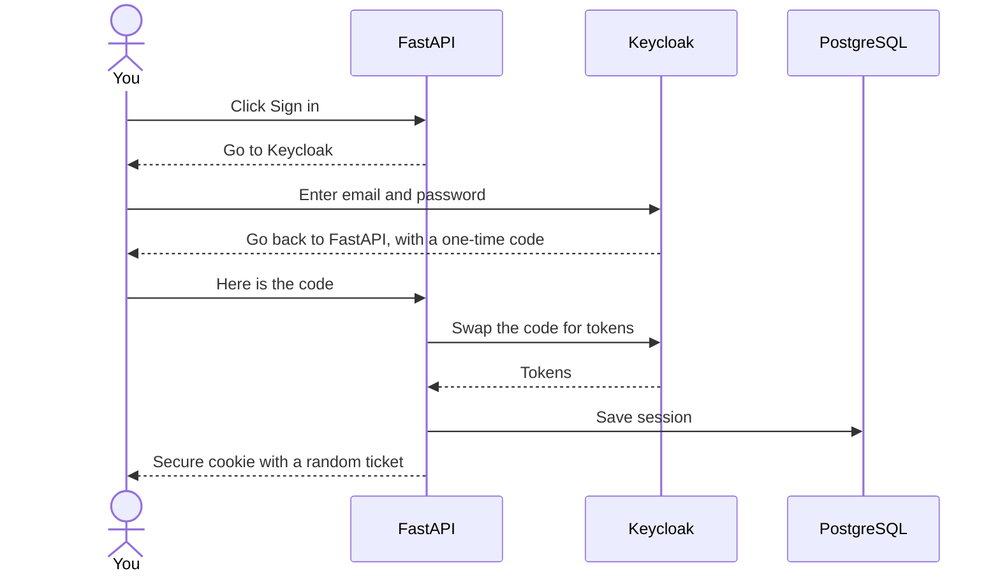

# Keycloak beginner's guide

This guide assumes you have never used Keycloak. It grows in Phase 1, as we build the login.

## What is Keycloak?

Keycloak is a free, open-source login system. Instead of building password storage, password reset and login pages ourselves, we let Keycloak do it. Many large companies use it.

Think of it like a hotel reception. Reception checks your ID once and gives you a room key. The rooms never see your ID, they only check the key.

## Words you will see

| Word | Simple meaning | In CostPilot |
|---|---|---|
| **Realm** | A separate space with its own users and settings | One realm called `costpilot` |
| **Client** | An app allowed to use Keycloak for login | Our FastAPI backend |
| **User** | A person who can log in | Each person who signs up |
| **Role** | A label that gives permission | For example, `admin` |
| **Token** | A signed digital pass that proves who you are | Keycloak gives one to FastAPI |
| **OpenID Connect (OIDC)** | The standard way apps talk to a login system | How FastAPI talks to Keycloak |
| **Authentication** | Proving who you are | Keycloak's job |
| **Authorization** | Deciding what you may do | Our backend's job |

## How CostPilot uses it



From then on, every request carries that ticket, and FastAPI looks up who you are. The browser never sees a token.

Keycloak knows **who you are**. Our database knows **which workspace is yours**.

## How sign-up works

1. A new user enters their email and name on the Register page. There is no password box yet.
2. Keycloak emails them a link. Locally, it appears in Mailpit at http://localhost:8025.
3. They open the link, which proves they own that email address.
4. They choose a password, and then they are signed in.

Keycloak asks for the password after the email check on purpose. Nobody can set a password on an email address they do not own.

## Using the admin dashboard

Open http://localhost:8090 and sign in as `admin`, with `KEYCLOAK_ADMIN_PASSWORD` from your `.env` file. Then use the realm menu at the top left to switch from `master` to **costpilot**.

| Task | Where |
|---|---|
| See who has signed up | **Users** |
| Reset someone's password | **Users** → pick a user → **Credentials** |
| Lock an account | **Users** → pick a user → turn off **Enabled** |
| See who is signed in | **Sessions** |
| See our backend's login settings | **Clients** → `costpilot-api` |
| Change password rules | **Authentication** → **Policies** |
| See login attempts | **Events** |

The `master` realm is only for managing Keycloak. App users never go there.

## Where the settings live

| File | What it does |
|---|---|
| `infra/keycloak/realm-costpilot.json` | The whole realm: rules, email settings and our backend client |
| `infra/keycloak/themes/costpilot/` | The green login page |
| `.env` | The client secret and addresses |

Keycloak reads the realm file when it starts, **but only if the realm does not exist yet**. Changes made in the dashboard are not saved to this file. If you change a setting that matters, add it to the file too.

To apply changes to the file, reset the local data. This deletes your local CostPilot users and database:

```bash
make down
docker volume rm costpilot_postgres_data
make up
```

## How the code uses Keycloak

| Step | File |
|---|---|
| Send the user to Keycloak and check the reply | `modules/identity/infrastructure/keycloak_provider.py` |
| The steps of signing in and out | `modules/identity/application/auth_service.py` |
| The web addresses | `modules/identity/api/routes.py` |

Three checks protect the login:

- **State:** a random value that proves the reply belongs to the login this browser started.
- **Nonce:** a random value inside the token that proves the token was made for this login.
- **PKCE:** a one-time secret that stops a stolen code from being used.

## Testing it

`make e2e` runs the whole journey in Chrome: sign up, verify the email, choose a password, sign out, sign in and ask for a password reset.
