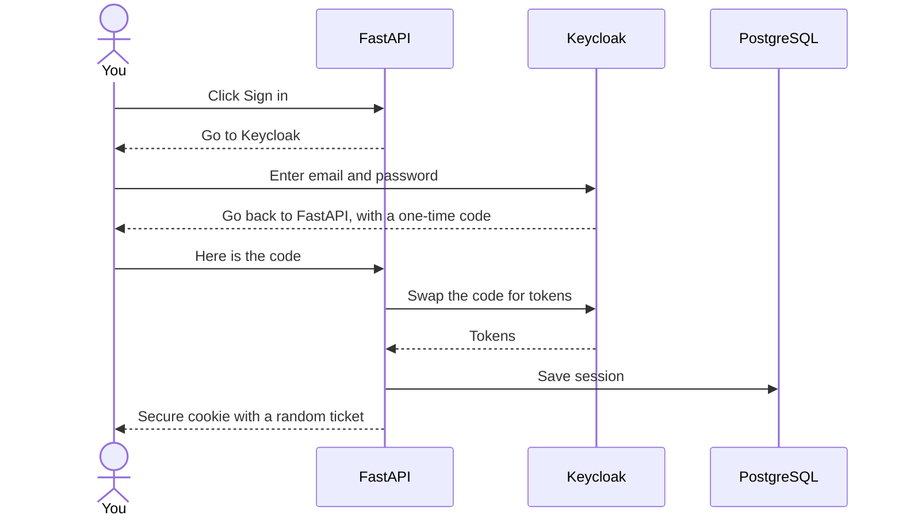

# Keycloak beginner's guide

This guide assumes you have never used Keycloak. It grows in Phase 1, as we build the login.

## What is Keycloak?

Keycloak is a free, open-source login system. Instead of building password storage, password reset and login pages ourselves, we let Keycloak do it. Many large companies use it.

Think of it like a hotel reception. Reception checks your ID once and gives you a room key. The rooms never see your ID, they only check the key.

## Words you will see

| Word | Simple meaning | In CostPilot |
|---|---|---|
| **Realm** | A separate space with its own users and settings | One realm called `costpilot` |
| **Client** | An app allowed to use Keycloak for login | Our FastAPI backend |
| **User** | A person who can log in | Each person who signs up |
| **Role** | A label that gives permission | For example, `admin` |
| **Token** | A signed digital pass that proves who you are | Keycloak gives one to FastAPI |
| **OpenID Connect (OIDC)** | The standard way apps talk to a login system | How FastAPI talks to Keycloak |
| **Authentication** | Proving who you are | Keycloak's job |
| **Authorization** | Deciding what you may do | Our backend's job |

## How CostPilot uses it

From then on, every request carries that ticket, and FastAPI looks up who you are. The browser never sees a token.

Keycloak knows **who you are**. Our database knows **which workspace is yours**.

## Try it now

1. Run `make up`.
2. Open http://localhost:8090.
3. Sign in as `admin`, with `KEYCLOAK_ADMIN_PASSWORD` from your `.env` file.
4. Look around. You are in the `master` realm, which is only for managing Keycloak. We never put app users there.

## What Phase 1 adds

- The `costpilot` realm, saved as a file so it rebuilds itself
- Sign-up, email verification and password reset
- A green login page that matches the app
- A walkthrough of each screen and setting
