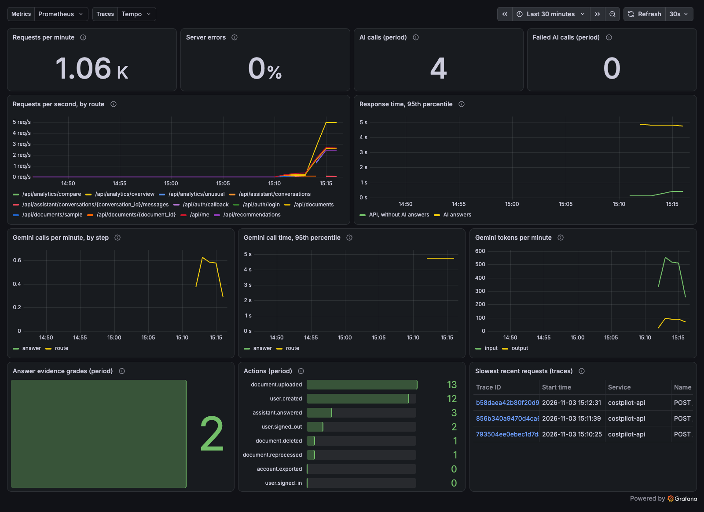

# Monitoring: traces, metrics and the Grafana dashboard

CostPilot reports what it is doing through **OpenTelemetry**, an open standard for sending traces and metrics. Any tool that understands it can show them. We use Grafana.

**New words, in one line each**

| Word | Meaning |
|---|---|
| **Trace** | The story of one request: every step it took, and how long each step lasted |
| **Span** | One step inside a trace, such as one database query or one Gemini call |
| **Metric** | A number measured over time, such as requests per second |
| **OTLP** | The way OpenTelemetry sends data. It is just HTTP |
| **Prometheus** | Stores metrics |
| **Tempo** | Stores traces |
| **Grafana** | Draws dashboards from Prometheus and Tempo |

## On your computer

```bash
make monitoring
```

This starts everything as usual, plus one extra container, `grafana/otel-lgtm`. It holds Prometheus, Tempo, Loki and Grafana together. Then open http://localhost:3011 and choose **Dashboards → CostPilot**.



| Panel | What it tells you |
|---|---|
| Requests per minute, server errors | Is the API busy, and is it failing? |
| Requests and response time by route | Which pages are slow |
| Gemini calls, call time and tokens | How much AI you use, and where answers spend their time |
| Answer evidence grades | How often answers had full evidence (A) or too little (D) |
| Actions | Uploads, sign-ins, answers, exports and deletions |
| Slowest recent requests | Click one to see its trace |

**What a trace of one AI answer looks like** (measured on 3 Nov 2026):

| Step | Time |
|---|---|
| `agent.supervisor`, which includes `gemini.route` | 2.07 s |
| `agent.retrieve_documents` | 0 ms, not needed for this question |
| `agent.cost_specialist` | 9 ms |
| `gemini.answer` | 1.66 s |

So almost all the waiting is Gemini. Our own code took about 50 ms.

`make up` turns monitoring off again. With no OTLP address set, the app records nothing and sends nothing.

## What is recorded, and what is not

| Recorded | Never recorded |
|---|---|
| Route, status code and time of each request | Request bodies, bills or uploaded files |
| Database query text, with values left out | Values passed into queries |
| Which agents ran, and how long each took | Questions, answers or prompts |
| Gemini call counts, times and token counts | Email addresses or names |

## In production: Grafana Cloud

Grafana Cloud has a free plan. Check its current limits when you sign up.

1. Create a free account at https://grafana.com and open your stack.
2. Go to **Connections → OpenTelemetry (OTLP)** and create a token.
3. Grafana shows an endpoint and an `Authorization` header. Put them in `infra/production/settings`:
   ```
   OTEL_EXPORTER_OTLP_ENDPOINT=https://otlp-gateway-<region>.grafana.net/otlp
   OTEL_EXPORTER_OTLP_HEADERS=Authorization=Basic%20<the long value Grafana shows>
   ```
   The `%20` stands for the space after `Basic`.
4. Copy the settings to the server again, then deploy. See the [deployment guide](deployment.md).
5. In Grafana Cloud, choose **Dashboards → New → Import** and upload `infra/monitoring/costpilot-dashboard.json`.

Production keeps 1 in 5 traces (`OTEL_TRACES_SAMPLER_ARG=0.2`). In the load test, tracing every request made the slowest 5% about 100 ms slower. Metrics are always complete, because sampling only affects traces.

## Changing the dashboard

Edit the panels in `scripts/build_dashboard.py`, then run:

```bash
python3 scripts/build_dashboard.py
docker compose restart monitoring
```
